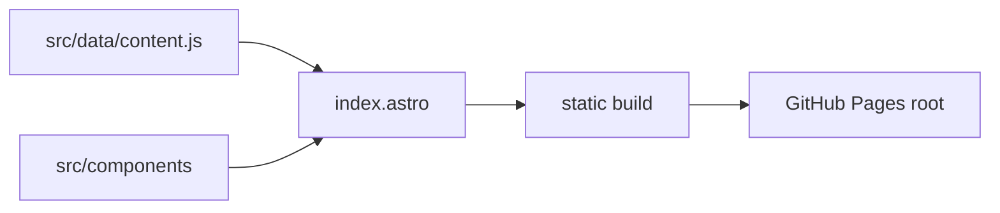

<div align="center">

# Portfolio

**The portfolio at the root of adineo-cmd.github.io.**

[](https://adineo-cmd.github.io/)
   

[](https://github.com/adineo-cmd/adineo-cmd.github.io/stargazers) [](https://github.com/adineo-cmd/adineo-cmd.github.io/commits)

[Live site](https://adineo-cmd.github.io/) · [Quick start](#quick-start) · [How it works](#how-it-works) · [Features](#features)

</div>

---

A single-page portfolio built with Astro and Tailwind: introduction, about,
selected projects, writings, reading library, a frozen list of 100 life goals,
and a timeline of milestones.

Content is data-driven, so the page changes without touching layout code.

## Features

| | Feature | What it does |
| --- | --- | --- |
| 🪪 | **Hero and about** | Who I am, what I work with and how I approach building. |
| 🧩 | **Project showcase** | Selected work with live and source links. |
| 📚 | **Writings and library** | Essays, reading list and collected notes. |
| 🗓️ | **List 100 and timeline** | Long-horizon goals next to the milestones so far. |

## How it works

The site is intentionally small:

1. `src/data/content.js` holds the about text, links, projects and timeline.
2. `src/pages/index.astro` renders the single page through one layout.
3. Tailwind and a custom zinc palette provide the theme; there is no client-side
   framework.
4. The Pages workflow builds and deploys on every push to `main`.



## Quick start

**Install and run**

```bash
npm install
npm run dev
```

**Production build**

```bash
npm run build
npm run preview
```

## Project structure

```text
src/pages/index.astro  the page
src/data/content.js    projects, about, links, timeline
src/components/        section components
src/layouts/           shared document shell
src/styles/            global CSS
public/images/         project and portrait images
```

## Deployment

Every push to `main` builds the site and deploys it to GitHub Pages through
`.github/workflows/deploy.yml`:

**https://adineo-cmd.github.io/**

The repository is the user site for the account, so it serves the domain root
rather than a sub-path.
